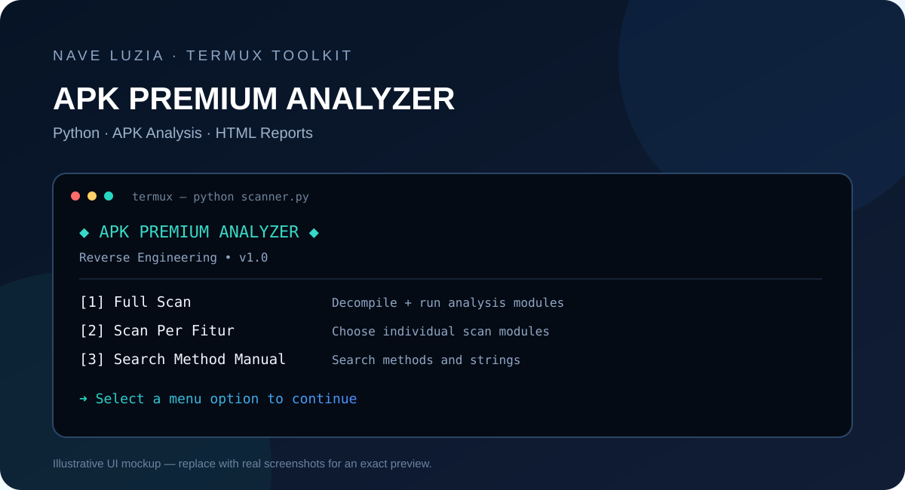

<div align="center">

# APK Premium Analyzer

**Python-based APK analysis toolkit for Termux**

[](https://www.python.org/)
[](https://termux.dev/)
[](#)

**By [@naveluzia](https://t.me/naveluzia)** · [YouTube](https://www.youtube.com/@naveluzia)

</div>

---

## Preview / Referensi Tampilan

> Gambar berikut adalah mockup ilustrasi tampilan terminal, bukan screenshot hasil eksekusi asli. Ganti dengan screenshot asli dari Termux jika sudah tersedia.



## Tentang Project

APK Premium Analyzer adalah tool berbasis Python yang dirancang untuk membantu **analisis struktur APK Android** di lingkungan Termux. Tool ini menyediakan pemindaian file hasil decompile, pencarian string dan method, analisis resource, serta pembuatan laporan HTML. Fitur patch/rebuild tersedia untuk pengujian pada aplikasi yang Anda miliki atau yang secara eksplisit Anda berwenang untuk analisis.

## Fitur

- **Full Scan** — menjalankan rangkaian analisis yang tersedia secara otomatis.
- **Scan Per Fitur** — memilih modul analisis satu per satu.
- **Search Method Manual** — mencari method, string, atau pola tertentu.
- **Detail Method** — menampilkan detail temuan terkait method dan flag aplikasi.
- **HTML Report** — menghasilkan laporan lokal yang dapat dibuka di browser.
- **Auto Patch / Rebuild / Sign** — alur eksperimen untuk APK milik sendiri atau yang telah mendapat izin.
- **Output terorganisasi** — hasil scan disimpan dalam folder output terpisah.
- **Installer Python** — `install.py` membantu memasang dependensi yang diperlukan di Termux.

## Persyaratan

- Android dengan [Termux](https://termux.dev/) terpasang.
- Koneksi internet untuk mengunduh paket/dependensi.
- Ruang penyimpanan yang cukup untuk APK dan hasil decompile.
- Izin penyimpanan Termux jika APK berada di folder penyimpanan bersama.

## Instalasi

1. Unduh atau clone repository ini ke Termux.

   ```bash
   pkg update && pkg upgrade -y
   pkg install -y git python
   git clone <https://github.com/naveluzia/ScanApk.git>
   cd <ScanApk>
   ```

2. Jalankan installer untuk memasang tools pendukung.

   ```bash
   chmod +x install
   ```
    
3. Installing

   ```bash
   ./install
   ```

3. Jalankan analyzer.

   ```bash
   chmod +x scanner
   ```

4. Run   

   ```bash
   ./scanner
   ```

> Jika Anda menjalankan file dari folder lain, sesuaikan perintah `cd` dengan lokasi project. Installer ditujukan untuk Termux dan mungkin membutuhkan koneksi internet serta ruang penyimpanan yang memadai.

## Cara Penggunaan

1. Jalankan `./scanner`.
2. Pilih menu yang ingin digunakan.
3. Pilih APK target saat diminta.
4. Tunggu proses analisis selesai.
5. Buka folder output yang ditampilkan tool untuk melihat file hasil scan dan laporan HTML.

## Struktur File

```text
.
├── scanner       # Program utama analyzer
├── install       # Installer dependensi Termux
├── README.md        # Dokumentasi repository
└── assets/
    └── preview.svg  # Ilustrasi referensi tampilan
```

## Catatan & Troubleshooting

- Jika instalasi gagal, jalankan `pkg update` lalu ulangi `python install.py`.
- Pastikan paket `java`, `wget`, `unzip`, `zip`, `python`, `aapt`, `apktool`, dan `jadx` tersedia; installer akan mencoba memasang tools tersebut.
- Jika laporan tidak terbuka otomatis, buka file `report.html` dari folder output menggunakan browser Android.
- Jangan hentikan proses ketika tool sedang mengunduh dependensi atau memproses APK.
- Gunakan APK cadangan untuk pengujian dan simpan file asli secara terpisah.

## Etika dan Legalitas

Gunakan tool ini hanya untuk pembelajaran, audit keamanan, debugging, dan analisis aplikasi yang Anda miliki atau telah mendapat izin untuk diuji. Patuhi hukum setempat, ketentuan layanan, serta hak kekayaan intelektual pemilik aplikasi. Jangan gunakan tool untuk menghindari pembayaran, membuka fitur berbayar tanpa izin, atau memodifikasi aplikasi pihak lain tanpa persetujuan.

## Screenshot Asli

Untuk menambahkan screenshot asli ke GitHub:

1. Buat folder `assets/priview.svg/`.
2. Simpan screenshot terminal dan contoh laporan HTML di folder tersebut.
3. Tambahkan gambar ke README, misalnya:

   ```markdown
   
   
   ```

## Credits

- **Project:** APK Premium Analyzer
- **Author:** [@naveluzia](https://t.me/naveluzia)
- **YouTube:** [youtube.com/@naveluzia](https://www.youtube.com/@naveluzia)

---

<div align="center">

Made for Android analysis and security research.

</div>
