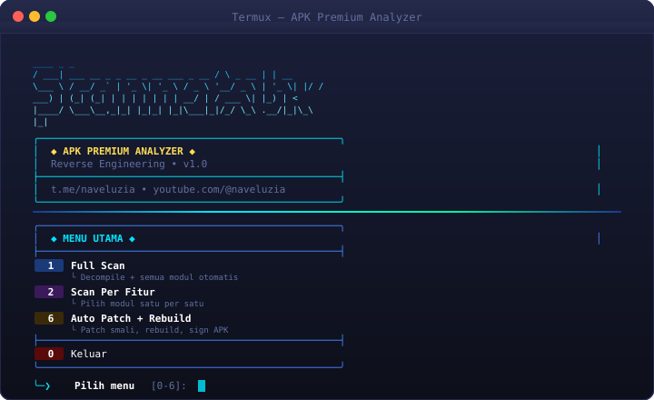
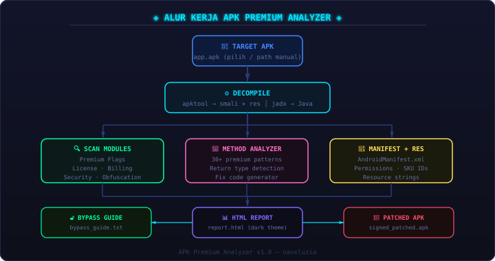

<div align="center">

```
   ____                                   _          _    
  / ___|  ___ __ _ _ __  _ __   ___ _ __ / \   _ __ | | __
  \___ \ / __/ _` | '_ \| '_ \ / _ \ '__/ _ \ | '_ \| |/ /
   ___) | (_| (_| | | | | | | |  __/ | / ___ \| |_) |   < 
  |____/ \___\__,_|_| |_|_| |_|\___|_|/_/   \_\ .__/|_|\_\
                                               |_|         
```

# APK Premium Analyzer

**Reverse engineering tool for Android APKs — runs on Termux**

[](https://termux.dev)
[](https://python.org)
[](LICENSE)
[](https://t.me/naveluzia)

[Fitur](#-fitur) · [Instalasi](#-instalasi) · [Cara Pakai](#-cara-pakai) · [Output](#-output) · [Tools](#-tools-yang-digunakan)

</div>

---



---

## Tentang

APK Premium Analyzer adalah tool analisis APK Android berbasis terminal yang berjalan langsung di Termux. Tool ini melakukan decompile, scan, dan analisis APK untuk menemukan **premium gates**, **license checks**, **billing hooks**, dan metode premium lainnya — lengkap dengan kode fix smali yang siap pakai dan panduan patch step-by-step.

Ditulis sepenuhnya dalam Python, dikonversi dari shell script dengan logika identik 100%.

---

## ✨ Fitur

### 🔍 Analisis & Scanning
| Modul | Deskripsi |
|---|---|
| **Premium Gate Flags** | Deteksi `isPremium`, `isSubscribed`, `isVip`, `isPro`, `isUnlocked`, dan 30+ pattern lainnya di Smali |
| **License Check Scan** | Temukan `LicenseChecker`, Google Play Licensing (`LICENSED`/`NOT_LICENSED`), custom license validator |
| **In-App Billing Scan** | Ekstrak SKU/product ID, `BillingClient`, `PurchasesUpdatedListener`, billing response codes |
| **Security Protections** | Deteksi root detection, emulator check, signature verification, anti-tamper |
| **Obfuscation Analysis** | Identifikasi ProGuard/R8, class dengan nama obfuscated (`a`, `b`, `c`), string encryption |
| **Manifest Analysis** | Parse `AndroidManifest.xml` — permissions, package name, activities, services, receivers |
| **Resource Strings** | Scan `strings.xml` dan resource lain untuk nilai premium/billing/license |

### 🎯 Premium Method Detail Analyzer
Untuk setiap method premium yang ditemukan, tool ini memberikan:
- **Lokasi lengkap**: path file smali + nomor baris
- **Kode asli**: isi method block dari smali
- **Return type detection**: boolean, int, void, object, long, double
- **Kode fix siap pakai**: patch smali yang tinggal copy-paste
- **Instruksi edit**: penjelasan per-opcode dalam bahasa Indonesia

### 🔓 Bypass Guide Generator
Auto-generate panduan patch berisi:
- Daftar semua file smali yang berisi method premium
- Lokasi `return-false` (`const/4 vN, 0x0`) yang harus diubah ke `0x1`
- IF-gate (`if-eqz`, `if-nez`) di method premium
- SharedPreferences premium keys
- Network calls untuk server-side license validation
- Panduan lengkap rebuild + sign APK dengan `apktool` & `apksigner`

### 🔧 Auto Patch + Rebuild
Menu interaktif untuk:
- Auto-patch method premium langsung dari tool
- Rebuild APK dengan `apktool b`
- Generate keystore & sign dengan `apksigner`
- Verify signature hasil build

### 📊 HTML Report
Laporan interaktif berbasis browser dengan dark theme:
- Summary card (jumlah findings per kategori)
- Collapsible sections per modul
- Kode smali ter-highlight
- Bypass guide siap baca
- Bisa dibuka langsung di browser HP

---

## 🗺️ Alur Kerja



---

## 📋 Requirements

| Dependency | Versi | Fungsi |
|---|---|---|
| Python 3 | 3.8+ | Runtime utama |
| Java / OpenJDK 17 | 17+ | Dibutuhkan apktool & jadx |
| apktool | 2.9.x | Decompile smali & resources |
| jadx | 1.5.x | Decompile Java source |
| wget | any | Download tools otomatis |
| unzip / zip | any | Ekstrak & pack file |
| aapt | any | Parse APK manifest |

> Semua dependency di-install otomatis oleh script `install`.

---

## 🚀 Instalasi

### 1. Clone repo

```bash
git clone https://github.com/naveluzia/ScannerApk.git
cd ScannerApk
```

### 2. Setup storage (wajib, sekali saja)

```bash
termux-setup-storage
```

Klik **Allow** di dialog permission yang muncul.

### 3. Install semua tools

```bash
chmod +x install
./install
```

Installer otomatis:
- Update package list
- Install Java, wget, unzip, zip, Python, aapt
- Install apktool (via pkg, fallback GitHub)
- Download & install jadx dari GitHub releases

Estimasi waktu: **2–5 menit** tergantung koneksi.

---

## 📖 Cara Pakai

```bash
chmod +x scanner
./scanner
```

### Menu Utama

```
  ╭──────────────────────────────────────────╮
  │         ◆  MENU UTAMA  ◆                 │
  ├──────────────────────────────────────────┤
  │  1   Full Scan                            │
  │      Decompile + semua modul otomatis    │
  │  2   Scan Per Fitur                       │
  │      Pilih modul satu per satu           │
  │  3   Search Method Manual                 │
  │      Cari method / string di smali       │
  │  4   Detail Premium Methods               │
  │      Hasil method premium + fix          │
  │  5   Lihat Report Terakhir                │
  │      Buka report HTML hasil scan         │
  │  6   Auto Patch + Rebuild                 │
  │      Patch smali, rebuild, sign APK      │
  ├──────────────────────────────────────────┤
  │  0   Keluar                               │
  ╰──────────────────────────────────────────╯
```

### Alur Kerja Tipikal

```
[1] Full Scan
    → Pilih APK dari daftar otomatis / input path manual
    → Decompile dengan apktool + jadx
    → Jalankan semua modul analisis
    → Generate HTML report
    
[4] Detail Premium Methods
    → Lihat kode smali asli + patch code siap pakai
    
[6] Auto Patch + Rebuild
    → Patch file smali
    → Rebuild APK
    → Sign APK
    → Siap install
```

---

## 📁 Output

Setiap scan menghasilkan folder di `~/APK_ANALYSIS/<nama_apk>_<timestamp>/`:

```
APK_ANALYSIS/
└── com.example.app_20261022_091530/
    ├── 01_smali/           ← Hasil decompile apktool (smali + resources)
    ├── 02_java/            ← Hasil decompile jadx (Java source)
    ├── 03_manifest/        ← AndroidManifest.xml
    ├── 04_resources/       ← Resource strings, drawables, dll
    ├── 05_analysis/
    │   ├── premium_gates/  ← Hasil scan premium flag
    │   ├── license_checks/ ← Hasil scan license
    │   ├── billing/        ← Billing hits + SKU IDs
    │   ├── security/       ← Security protection findings
    │   └── obfuscation/    ← Obfuscation analysis
    ├── 06_premium_methods/ ← Detail method + fix code
    ├── 07_bypass/          ← Bypass guide lengkap
    └── 08_report/
        └── report.html     ← Laporan interaktif (buka di browser)
```

---

## 🛠️ Tools yang Digunakan

| Tool | Fungsi |
|---|---|
| [apktool](https://github.com/iBotPeaches/Apktool) | Decompile APK ke smali + decode resources |
| [jadx](https://github.com/skylot/jadx) | Decompile APK/DEX ke Java source |
| [aapt](https://developer.android.com/studio/command-line/aapt2) | Parse APK manifest & resources |

---

## ⚠️ Disclaimer

Tool ini dibuat untuk keperluan **security research**, **reverse engineering**, dan **pembelajaran**. Gunakan hanya pada APK yang kamu miliki atau yang sudah mendapat izin eksplisit dari pemiliknya.

Penulis tidak bertanggung jawab atas penyalahgunaan tool ini.

---

## 👤 Author

**naveluzia**

- Telegram: [@naveluzia](https://t.me/naveluzia)
- YouTube: [youtube.com/@naveluzia](https://youtube.com/@naveluzia)

---

<div align="center">
<sub>APK Premium Analyzer v1.0 — made with ☕ in Termux</sub>
</div>
